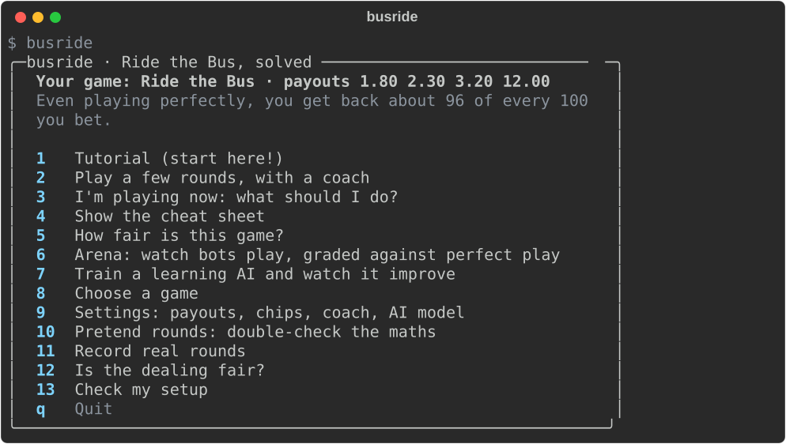
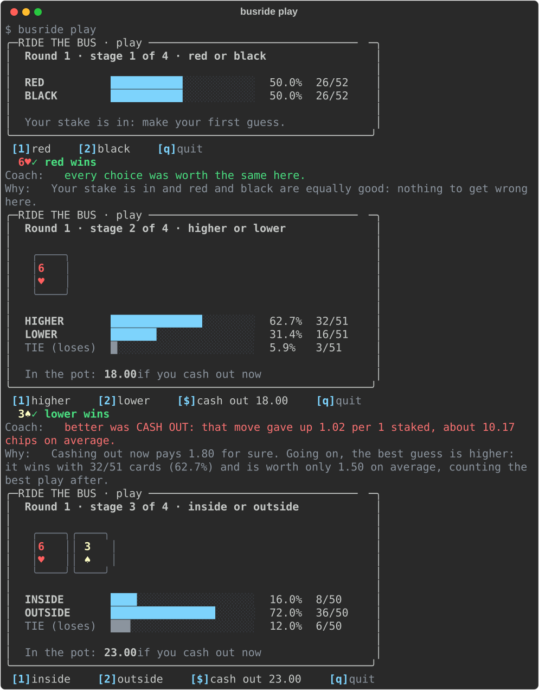
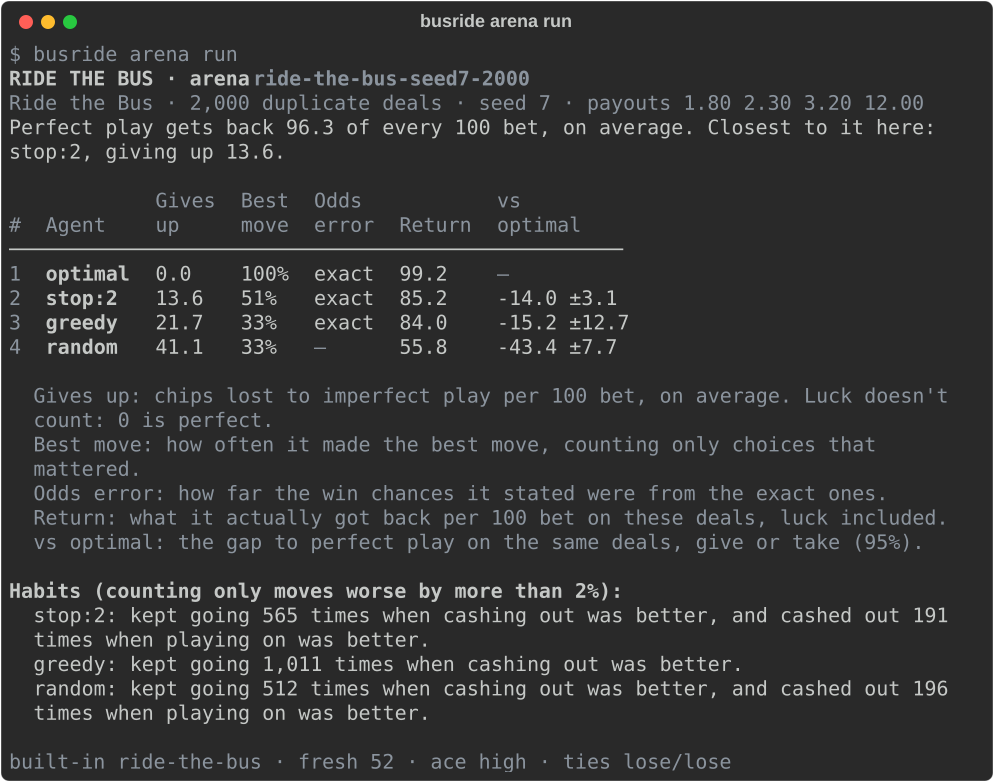
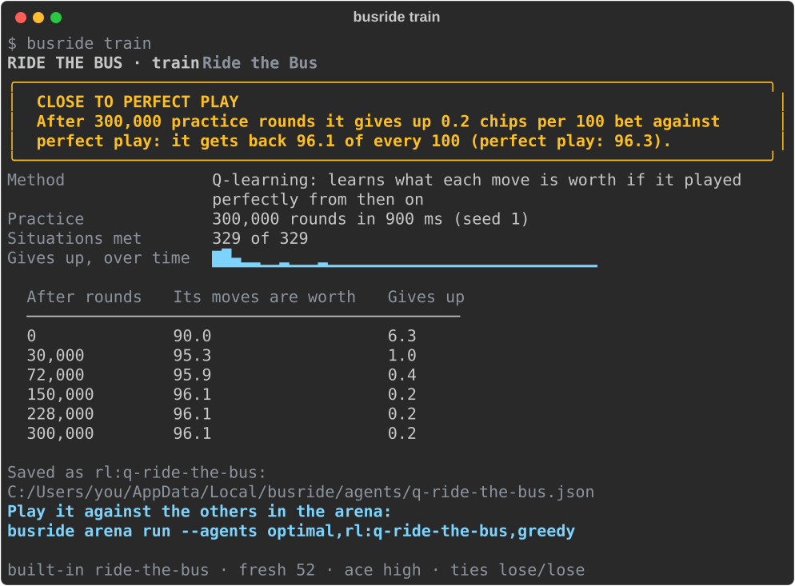
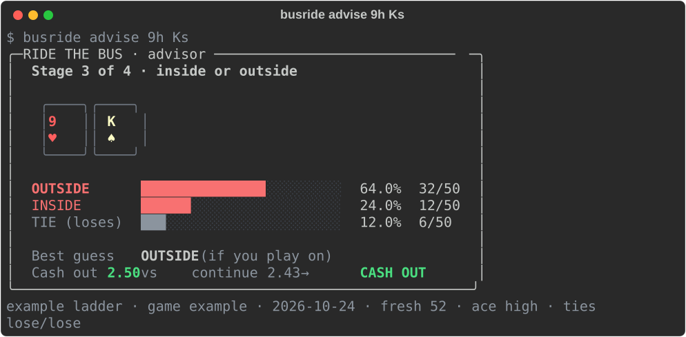
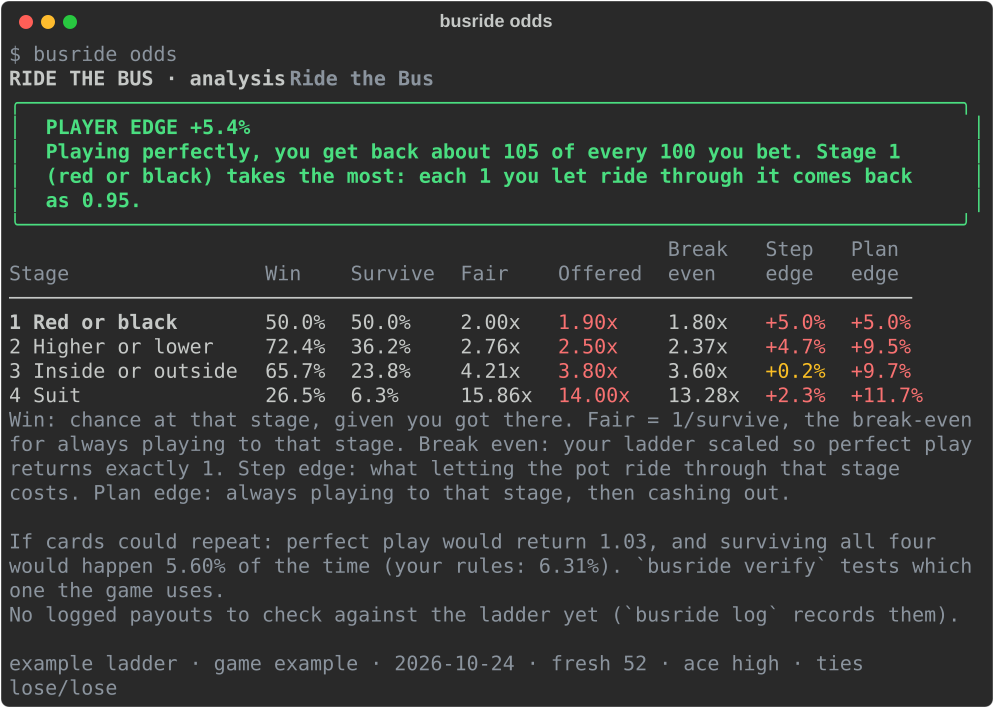

# busride

[](https://github.com/kkdoestech/busride/actions/workflows/ci.yml)

**Ride the Bus, solved.** The card game is small enough to work out perfect play *exactly*, so
every decision has a right answer. busride turns that answer key into three things, all in your
terminal:

- **Learn and play.** Play with fake chips while a coach grades every move, ask what to do with
  the cards in front of you, or keep the whole strategy open as a cheat sheet.
- **Benchmark AI models.** Claude, DeepSeek, GPT or a free model on your own computer play the
  same deals as perfect play, and every decision is graded exactly: luck doesn't decide the
  ranking.
- **Train a learning AI.** Watch Q-learning teach itself the game from nothing, with a learning
  curve measured exactly.



## Start in 2 commands

You need [uv](https://docs.astral.sh/uv/) (one line to install: see
[GUIDE.md, Part 3.2](GUIDE.md#32-install-uv-once)). Then:

```sh
git clone https://github.com/kkdoestech/busride.git && cd busride
uv run busride
```

The first run downloads what busride needs (about a minute); after that it starts in a second.
Nothing to configure: you start with classic Ride the Bus and the home menu. **New to the
terminal, or to the maths?** [GUIDE.md](GUIDE.md) explains every screen from scratch.

| You want to... | Type |
| --- | --- |
| learn the basics | `busride tutorial` |
| play with fake chips while a coach grades each move | `busride play` |
| know what to do with the cards in front of you | `busride advise 9h Ks` |
| see the best play for every situation | `busride cheatsheet` |
| know how fair a game is, and where it takes its edge | `busride odds` |
| watch bots play the same deals, graded against perfect play | `busride arena run` |
| see how an AI model plays | `busride arena run --agents optimal,deepseek` (or `claude`, `ollama:MODEL`) |
| play those deals yourself and see where you rank | `busride arena run --agents human,optimal,greedy` |
| watch an AI teach itself the game | `busride train` |
| switch game, or make your own | `busride games`, `busride games use hi-lo-5`, `busride games new` |
| check your setup | `busride doctor` |

(Inside the folder, `uv run busride ...`; or run `uv tool install .` once to type `busride`
anywhere.)

## Play with a coach



The coach shows the odds before you choose and, after, whether your move was the best one and
what it gave up. "Gave up" is the best move's value minus your move's value: it grades the
decision, not the luck of the next card. The session summary splits your result into skill
and luck.

## The arena: an exact benchmark

Usually you can't tell a good player from a lucky one without thousands of rounds. Here every
agent plays the **same deals**, and each decision is graded by what it gave up against the best
move, so 2,000 deals rank the built-in bots in about a second, and 20 deals already say a lot
about an AI model.



### A real run: AI models against the answer key

Seven agents on the same 30 deals (October 2026, `--deals 30`, seed 7): the built-in bots, an
agent trained with `busride train`, DeepSeek-flash through its API, and a 4-billion-parameter
model running locally in Ollama.

```
RIDE THE BUS · arena   example
Ride the Bus · 30 duplicate deals · seed 7 · payouts 1.80 2.30 3.20 12.00
Perfect play gets back 96.3 of every 100 bet, on average. Closest to it here:
deepseek:deepseek-flash, giving up 0.0.

                             Gives  Best      Odds                   vs
#  Agent                        up  move     error  Return      optimal   Cost
──────────────────────────────────────────────────────────────────────────────
1  optimal                     0.0  100%     exact    89.3            —      —
2  deepseek:deepseek-flash     0.0  100%   0.4 pts    89.3    +0.0 ±0.0  $0.06
3  rl:q-ride-the-bus           0.1   96%         —   118.7  +29.3 ±57.5      —
4  stop:2                     11.6   52%     exact    61.3  -28.0 ±24.7      —
5  greedy                     15.2   41%     exact    80.0   -9.3 ±93.5      —
6  random                     32.6   50%         —    80.3   -9.0 ±60.7      —
7  ollama:qwen3:4b-instruct   63.2   24%  10.8 pts     0.0  -89.3 ±42.0   free
```

DeepSeek-flash made the best move on every decision of these deals, stating its win chances
within half a point, for six cents; its replays show it working out expected values ("12×13/49
≈ 3.184, slightly below the 3.20 cash-out"). The small local model gave up 63 chips per 100
bet: it guessed inside on an ace-jack spread, calling it 50% when it is 16%. Thirty deals is a
first look, not a verdict: run more with `--deals`, and expect AI results to vary from run to run.

```sh
busride arena run --agents optimal,deepseek --deals 20           # DeepSeek (deepseek-flash): cents
busride arena run --agents optimal,claude                        # Claude (claude-opus-5-5)
busride arena run --agents optimal,ollama:qwen3:4b-instruct      # a model on your computer: free
busride arena replay --agent deepseek:deepseek-flash --worst     # its costliest moves, with its reasons
```

- **Each decision** is one request with the rules, the cards and the legal moves; the model
  answers with a tool call (a guess with its win chance and a reason, or cash out), or in JSON if
  it has no tools. An unusable answer gets one retry, then counts as a forfeit.
- **Keys** come from your terminal or a `.env` file (copy `.env.example`; `.env` is git-ignored):
  `ANTHROPIC_API_KEY`, `DEEPSEEK_API_KEY`, `OPENAI_API_KEY`, `OPENROUTER_API_KEY`,
  `GROQ_API_KEY`. Ollama and LM Studio need none. `busride doctor` says which it finds, never
  their values.
- **Cost guard:** before a paid model plays, busride shows an estimate, plays one deal to
  measure the real cost, and asks again. `--max-cost 2` stops at $2; local models and
  OpenRouter `:free` models are free. `busride arena prices` shows the dated price table.
- Runs are saved as you go, so the same command carries on where it stopped; `--name` lets you
  add agents to a run later. `busride arena agents` lists everyone who can play.

## A learning AI that teaches itself



```sh
busride train                                       # Q-learning, about a second
busride train --method sarsa --name careful         # the more cautious method
busride arena run --agents optimal,rl:q-ride-the-bus,greedy
```

It starts knowing nothing and sees only what each round paid. It practises on the solver's own
game tree, so practice is fast and faithful, and every point of its curve is the *exact* value
of what it has learned so far. Bigger games need more practice (`hi-lo-5` has 28,000
situations). To train agents with other libraries, there's a Gymnasium environment:
`uv sync --extra rl`, then `from busride.agents.rl.env import BusRideEnv`.

## Advice, the cheat sheet and the odds





Any command takes `--ladder` to try other payouts for one run, as numbers or a preset:

```sh
busride odds --ladder classic     # 2x 3x 4x 20x looks fair, and gives perfect play a 31% edge
```

## Games

| Game | What you do | Perfect play returns |
| --- | --- | --- |
| `ride-the-bus` | Red or black, higher or lower, inside or outside, then the suit | 96.3% |
| `hi-lo-5` | One card is shown, then five higher-or-lower calls, each against the card before | 96.2% |
| `in-between` | Two cards are shown; bet whether the third lands between them | 97.5% |
| `colour-run-5` | Five red-or-black calls in a row | 97.5% |

A game is a small TOML file: [`examples/`](examples/) has a short deck, a two-deck shoe, a game
judged against the first card, and one where you may walk away. `busride games new` writes one
for you. Try any with `--game examples/short-deck.toml`.

## How it works

- **Exact solver:** backward induction over every situation the game can reach. Each seen card
  is reduced to what the remaining stages can still use, and suits that don't matter are
  merged, so Ride the Bus has 329 situations and solves in hundredths of a second.
- **An independent check:** `busride simulate` deals and judges cards with its own code, never
  the solver's, and must agree within its error bars.
- **Grading:** a decision's regret is the best move's value minus the chosen move's; its sum per
  deal averages exactly to perfect play's return minus the agent's.
- **Learning:** tabular Q-learning and SARSA on the solver's states, scored by exact policy
  evaluation; with real cards, each learned move is matched to the real guess with the same
  outcomes.
- **Fairness check:** `busride log` records real rounds and `busride verify` tests the dealing
  (duplicates, rank and suit counts, colour, repeats between rounds, Holm-corrected). It can
  reject a deck model, never certify a game as fair.

The full specification is [`docs/SPEC.md`](docs/SPEC.md); what's done and what's next is in
[`docs/ROADMAP.md`](docs/ROADMAP.md).

## Tests

```sh
uv run pytest                     # about 400 tests, a minute and a half
uv run ruff check src tests
uv run mypy                       # strict
```

They include the exact survival odds (0.50000, 0.36199, 0.23771, 0.06307), brute-force checks
of every game, the simulator against the solver, perfect play giving up exactly 0 in the arena,
AI agents against fake servers (nothing is sent anywhere), the learning AI reaching within 1% of
perfect play, and every screen at 80 columns in colour, `--plain` and `--ascii`. Live AI tests
are opt-in (`tests/test_live.py`). CI runs on Linux, macOS and Windows with Python 3.11 and 3.13.

## Contributing

See [CONTRIBUTING.md](CONTRIBUTING.md): setup, the checks, and the project's few rules (the
maths stays exact; every screen makes sense to a first-time player).

## Honesty limits

busride works only from the rules you give it and the cards you type. It reports the house edge
as a measurement, not a way around it. It uses fake chips and has no real-money features. AI
results vary from run to run, so small samples are a first look, not a verdict.

## Licence

[MIT](LICENSE).
